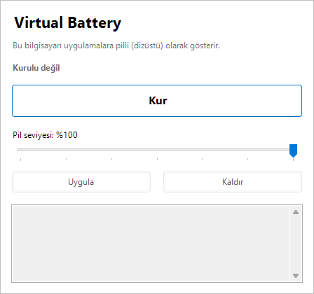

# Virtual Battery

[Türkçe](README.md)

**Adds a virtual battery to a desktop PC. One exe, one click. No Test Mode, no disabling Secure Boot, no custom kernel driver.**

Some games and programs treat remote sessions differently on PCs without a battery (desktops). The best known example is **Knight Online**: over **RDP** or **AnyDesk** the character cannot be controlled on a desktop PC, while laptops are reported to work. Virtual Battery makes Windows see the PC as battery powered.

<p align="center"></p>

## Install

1. Download `VirtualBatterySetup.exe` from the [latest release](../../releases/latest).
2. Open it and press **Install**. A battery icon appears in the taskbar within seconds.
3. Restart the game and connect remotely.

Install it on the PC you connect to (where the game runs). No background application is left running, and the battery survives restarts.

> **SmartScreen:** the exe is not signed with a paid publisher certificate, so Windows may warn on first launch (*More info → Run anyway*). You can [verify](#verify-your-download) that the file was built from this repository.

**Requires** Windows 10 2004 (19041) or newer / Windows 11, 64-bit Intel/AMD.

## Uninstall

Settings → Apps → **Virtual Battery** → Uninstall, or open the exe and press **Uninstall**. The device, driver package, certificate, files and registry entries are removed.

## Why it is safe

| | Similar tools (simbatt / WDTF) | Virtual Battery |
|---|---|---|
| Custom kernel driver | Yes | **No** |
| Secure Boot | Must be disabled | **Stays on** |
| Test Mode (`testsigning`) | Must be enabled | **Not needed** |
| Trusted certificate | Same for everyone, someone else holds the key | **Created per PC, key destroyed immediately** |
| Who can change battery data | Any signed-in program | **Administrators only** |
| Risk of sleep / shutdown | Yes, when faking a low battery | **Always plugged in, never below 40%** |

**How it works.** Windows ships with `HidBatt.sys`, the driver for USB uninterruptible power supplies. Virtual Battery creates a virtual HID power device for it to bind to. The only driver code in this project ([`driver/VirtualBattery.c`](driver/VirtualBattery.c)) runs in user mode, inside `WUDFHost.exe`, not in the kernel.

```
VirtualBattery.dll  (this project, user mode)
        ↓
mshidumdf.sys → HidClass → HidBatt.sys   (Microsoft, part of Windows)
        ↓
Windows power manager → battery icon, GetSystemPowerStatus, Win32_Battery
```

**Why a certificate?** Windows requires every driver package to be signed. Setup creates a key on your PC just to sign this package, signs it, and deletes the key. Only the public certificate is added to the trusted stores; since its key no longer exists it can never sign anything else. It is not a CA, and it is deleted on uninstall.

**What it does not do.** It does not access the internet, touch the game, read its memory, change its files, or inject code into any program.

## Good to know

- **No guarantee about any game.** The application makes Windows report a battery, and that is tested automatically for each release. How a game treats remote sessions is up to the game and may change with updates.
- **Terms of service:** your game's rules may restrict remote access or tools like this. Checking them, and any consequences, are your responsibility.
- This project is not affiliated with Knight Online, its publishers, AnyDesk or Microsoft; names are trademarks of their owners.

## Troubleshooting

| Symptom | Fix |
|---|---|
| Installed but no battery icon | Restart the PC. |
| Signature/policy error during setup | Smart App Control or a company policy may be blocking it. Setup rolls itself back. |
| Battery is there, game still not controllable | Close the game completely and reopen it; run the remote access program as administrator. |

Silent install: `VirtualBatterySetup.exe /install /quiet` · uninstall: `/uninstall /quiet`
(exit code 0: ok, 1: error, 2: already running, 3010: restart required)

## Verify your download

The published exe is built from this repository by GitHub Actions and carries a build attestation:

```powershell
gh attestation verify VirtualBatterySetup.exe --repo azorkai/virtual-battery-windows
```

## Build from source

Visual Studio 2022 C++ tools and the .NET SDK are enough; the Windows SDK/WDK come from pinned, hash-checked NuGet packages.

```powershell
.\build.ps1     # out\VirtualBatterySetup.exe
```

Tests: [`tests/integration.ps1`](tests/integration.ps1) installs, exercises, removes, and checks that nothing is left behind. [`tests/vm`](tests/vm) runs it on a **real Windows 11 VM with Secure Boot on and test signing off**.

## Credits

[zVirtualBattery](https://www.lab-z.com/zvb/) and [VirtualBatteryWin11](https://github.com/asilbalaban/VirtualBatteryWin11) for the idea; [HIDPowerDevice](https://github.com/abratchik/HIDPowerDevice) as a reference for the HID power device layout.

[MIT License](LICENSE)
