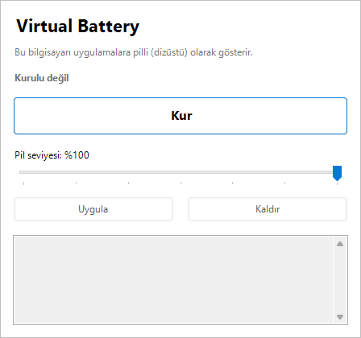

# Virtual Battery

[English](README.en.md)

**Masaüstü bilgisayara sanal pil ekler. Tek exe, tek tık. Test Modu yok, Secure Boot kapatma yok, çekirdek sürücüsü yok.**

Bazı oyunlar ve programlar pili olmayan (masaüstü) bilgisayarlarda uzaktan bağlantıyı farklı ele alır. En bilinen örnek **Knight Online**: masaüstü bilgisayara **RDP** veya **AnyDesk** ile bağlanınca karakter klavye/fare ile yönetilemiyor, dizüstünde ise bu sorunun yaşanmadığı bildiriliyor. Virtual Battery, Windows'un bilgisayarı pilli görmesini sağlar.

<p align="center"></p>

## Kurulum

1. [Son sürümden](../../releases/latest) `VirtualBatterySetup.exe` dosyasını indirin.
2. Açın, **Kur** düğmesine basın. Birkaç saniye sonra görev çubuğunda pil simgesi görünür.
3. Oyunu yeniden başlatın ve uzaktan bağlanın.

Program, uzaktan bağlandığınız (oyunun çalıştığı) bilgisayara kurulur. Arka planda çalışan bir uygulama bırakmaz; pil, bilgisayar yeniden başlatılınca da kalır.

> **SmartScreen uyarısı:** Exe ücretli bir yayıncı sertifikasıyla imzalı değildir, bu yüzden Windows ilk açılışta uyarabilir (*Ek bilgi → Yine de çalıştır*). İndirdiğiniz dosyanın bu depodaki kaynaktan derlendiğini [doğrulayabilirsiniz](#indirdiğiniz-dosyayı-doğrulama).

**Gereksinim:** Windows 10 2004 (19041) veya üzeri / Windows 11, 64 bit Intel/AMD.

## Kaldırma

Ayarlar → Uygulamalar → **Virtual Battery** → Kaldır, ya da exe'yi açıp **Kaldır**. Aygıt, sürücü paketi, sertifika, dosyalar ve kayıt girdileri silinir.

## Neden güvenli?

| | Benzer araçlar (simbatt / WDTF) | Virtual Battery |
|---|---|---|
| Özel çekirdek sürücüsü | Var | **Yok** |
| Secure Boot | Kapatılmalı | **Açık kalır** |
| Test Modu (`testsigning`) | Açılmalı | **Gerekmez** |
| Güvenilen sertifika | Herkes için aynı, anahtarı başkasında | **Her bilgisayarda ayrı üretilir, anahtarı hemen yok edilir** |
| Pil verisini kim değiştirebilir | Oturum açan her program | **Yalnızca yönetici** |
| Bilgisayarı uyutma / kapatma riski | Düşük pil taklidinde var | **Pil hep fişe takılı, en az %40** |

**Nasıl çalışıyor?** Windows, USB'li kesintisiz güç kaynaklarını (UPS) tanıyan `HidBatt.sys` sürücüsüyle birlikte gelir. Virtual Battery, bu sürücünün bağlandığı sanal bir HID güç aygıtı oluşturur. Projedeki tek sürücü kodu ([`driver/VirtualBattery.c`](driver/VirtualBattery.c)) çekirdekte değil, kullanıcı modunda (`WUDFHost.exe` içinde) çalışır.

```
VirtualBattery.dll  (bu proje, kullanıcı modu)
        ↓
mshidumdf.sys → HidClass → HidBatt.sys   (Microsoft, Windows ile gelir)
        ↓
Windows güç yönetimi → pil simgesi, GetSystemPowerStatus, Win32_Battery
```

**Sertifika neden ekleniyor?** Windows her sürücü paketinin imzalı olmasını ister. Kurulum, bilgisayarınızda yalnızca bu paketi imzalamak için bir anahtar üretir, imzalar ve anahtarı siler. Güvenilen depolara yalnızca açık sertifika eklenir; anahtarı artık var olmadığı için başka hiçbir şeyi imzalayamaz. Sertifika yetkili (CA) değildir, kaldırınca silinir.

**Ne yapmaz?** İnternete bağlanmaz, oyuna dokunmaz, belleğini okumaz, dosyalarını değiştirmez, hiçbir programa kod enjekte etmez.

## Bilinmesi gerekenler

- **Oyunla ilgili garanti yoktur.** Uygulama Windows'un pil bildirmesini sağlar, bu her sürümde otomatik olarak test edilir. Oyunun uzaktan bağlantıyı nasıl ele aldığı oyuna bağlıdır ve güncellemelerle değişebilir.
- **Kullanım koşulları:** Oyununuzun kuralları uzaktan bağlantıyı veya bu tür araçları kısıtlıyor olabilir. Kontrol etmek ve sonuçları sizin sorumluluğunuzdadır.
- Bu proje Knight Online, yayıncıları, AnyDesk veya Microsoft ile bağlantılı değildir; adlar sahiplerinin markalarıdır.

## Sorun giderme

| Belirti | Çözüm |
|---|---|
| Kuruldu ama pil simgesi yok | Bilgisayarı yeniden başlatın. |
| Kurulum imza/ilke hatası veriyor | Akıllı Uygulama Denetimi veya kurumsal ilke engelliyor olabilir. Kurulum yaptıklarını kendiliğinden geri alır. |
| Pil var, oyun yine yönetilemiyor | Oyunu tamamen kapatıp açın; uzaktan bağlantı programını yönetici olarak çalıştırın. |

Sessiz kurulum: `VirtualBatterySetup.exe /install /quiet` · kaldırma: `/uninstall /quiet`
(çıkış kodu 0: tamam, 1: hata, 2: program zaten açık, 3010: yeniden başlatma gerekli)

## İndirdiğiniz dosyayı doğrulama

Yayınlanan exe GitHub Actions üzerinde bu depodan derlenir ve derleme kaydıyla birlikte gelir:

```powershell
gh attestation verify VirtualBatterySetup.exe --repo azorkai/virtual-battery-windows
```

## Kaynaktan derleme

Visual Studio 2022 C++ araçları ve .NET SDK yeterlidir; Windows SDK/WDK sabit sürümle, özeti doğrulanarak NuGet'ten indirilir.

```powershell
.\build.ps1     # out\VirtualBatterySetup.exe
```

Testler: [`tests/integration.ps1`](tests/integration.ps1) kurar, dener, kaldırır ve iz kalmadığını denetler. [`tests/vm`](tests/vm) aynı testi **Secure Boot açık, test imzası kapalı gerçek Windows 11** sanal makinesinde çalıştırır.

## Teşekkür

Fikir için [zVirtualBattery](https://www.lab-z.com/zvb/) ve [VirtualBatteryWin11](https://github.com/asilbalaban/VirtualBatteryWin11); HID güç aygıtı tanımı için [HIDPowerDevice](https://github.com/abratchik/HIDPowerDevice).

[MIT Lisansı](LICENSE)
